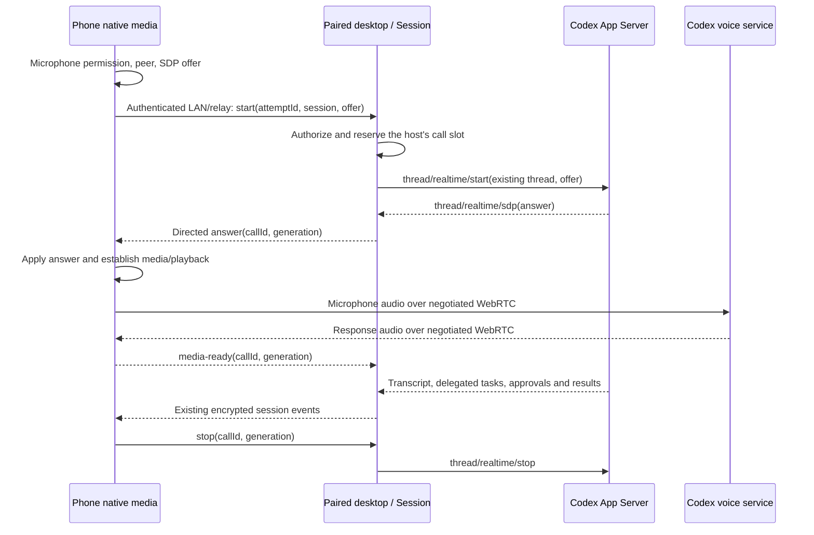

# Mobile Codex realtime voice

Status: accepted · Updated: 2026-10-10
Plan: [mobile-codex-realtime-voice.md](../plans/mobile-codex-realtime-voice.md)

Scope: foreground voice in the Expo/React Native app under `apps/mobile`, on an
existing Codex session hosted by a paired, online desktop. The phone owns capture,
playback and WebRTC media; the desktop owns the official Codex account, thread,
permissions and task execution. Native delivery/release is a separate task.

Related: [Codex contracts](../harness/codex/contracts.md#realtime-voice),
[Codex mobile gap G2](../harness/codex/backlog.md#integration-gaps),
[mobile control protocol](../architecture/mobile-remote-control.md),
[desktop ownership](../../apps/desktop/docs/agent-reference/architecture.md#remote-control-mobile-architecture).

## 1. Problem and current behavior

A paired phone can open a Codex conversation and display its voice transcript,
but cannot start a call or carry its audio. Users must currently use the desktop
microphone and speakers. The first release should let the phone become the
conversation's audio endpoint while work continues on that same desktop thread.

The following was checked in this checkout; it is source evidence, not a mobile
connection test.

| Surface | Implemented behavior / gap | Source |
|---|---|---|
| Codex start | `buildCodexRealtimeStartParams` sends `v3`, audio output, startup context, transcript-tail flushing and `{ type: 'webrtc', sdp }`. `startCodexRealtime` uses `thread/realtime/start` on the existing thread and rejects custom API providers. | [codex-realtime.ts](../../apps/desktop/src/main/codex/codex-realtime.ts) |
| Desktop media | A renderer singleton owns microphone, peer, playback and call-lifetime event listeners. It creates an offer, waits for ICE gathering, calls `window.agent.startRealtimeVoice`, then applies `realtime_sdp` as the answer. It gates one renderer call; this does not establish host-wide exclusivity across phones and windows. | [realtime-call.ts](../../apps/desktop/src/renderer/src/stores/realtime-call.ts) |
| Session control | `Session.startRealtimeVoice` reuses backend startup and effective directories. The Codex backend reapplies the backing model, effort and permission selection; `startCodexRealtime` synchronizes thread selection. Desktop IPC applies the preferred voice. | [session.ts](../../apps/desktop/src/main/session/session.ts), [codex-backend.ts](../../apps/desktop/src/main/session/backends/codex-backend.ts), [agent-service.ts](../../apps/desktop/src/main/agent/agent-service.ts) |
| Phone control | `RemoteCommand` has no voice start/stop/status operations. Environment capabilities and the routed command handler do not expose a complete voice path. | [agent-types.ts](../../packages/shared/src/agent-types.ts), [capabilities.ts](../../packages/shared/src/environment/capabilities.ts), [environment-commands.ts](../../apps/desktop/src/main/remote/environment-commands.ts) |
| Native media | Expo 54, React Native 0.81.5 and `expo-dev-client` are present; `react-native-webrtc` is absent. | [mobile package.json](../../apps/mobile/package.json) |
| Transcript | Mobile restores `realtimeSegments` and `activeRealtimeSessionId`. Chat-core takes completed transcript items, ignores partials, tracks start/close and deduplicates replay by provider item. Mobile merges these segments with normal messages for the Chat WebView. | [runtime.ts](../../apps/mobile/src/runtime.ts), [reducer.ts](../../packages/chat-core/src/reducer.ts), [use-transcript-sync.ts](../../apps/mobile/src/navigation/use-transcript-sync.ts) |
| Navigation and subscriptions | `subscribe_session` releases other subscriptions unless preserved; `leave_session` releases ownership and unsubscribes. Mobile chat switching sends `leave_session`. Device disconnect releases ownership/subscriptions. These paths need call-aware lifetime handling. | [agent-service.ts](../../apps/desktop/src/main/agent/agent-service.ts), [mobile-app.tsx](../../apps/mobile/src/navigation/mobile-app.tsx), [device-registry.ts](../../apps/desktop/src/main/remote/device-registry.ts) |

The current mapped `realtime_sdp` carries only an SDP string. Ordinary mobile
events are routed to session subscribers/owner by
[MobileBroadcaster](../../apps/desktop/src/main/remote/mobile-broadcaster.ts).
Phone negotiation therefore needs explicit endpoint routing and attempt fencing;
adding a start command and broadcasting the answer is insufficient.

## 2. Goals and first-release boundaries

- Start and end voice from a supported, existing Codex session on a paired phone.
- Keep the official account, existing thread, tools, sandbox and approvals on
  the desktop. Preserve the session's model/effort selection and history.
- Capture and play audio natively on the phone, with independent input/output
  mute, a media-ready signal and visible failure/retry states.
- Retain the call when switching chats while the app remains foreground; keep
  hangup and the route back to the call's conversation reachable.
- Enforce one call per desktop host, including pending starts, across desktop
  windows and paired phones. Reject a second endpoint without taking over.

First-release product policy: leaving the foreground, including screen lock,
ends voice. Chat and already submitted tasks remain available. Returning to the
foreground does not reopen the microphone. This is proposed behavior, not an
existing mobile implementation.

Non-goals: independent phone-side Codex execution or login; generic public
Realtime API agents or API-key provisioning; partial live captions; ongoing
background/locked-screen calls; multi-endpoint audio; seamless desktop-to-phone
handoff; seamless network migration; and voice on routed CLI environments.

## 3. Recommended architecture

Reuse the Codex-account integration's SDP path. The phone creates its own peer
connection and offer. The desktop submits that offer through App Server using
its account and returns the answer to the initiating phone. The desktop does
not first create a media connection and does not acquire its audio devices.

The answer is connection negotiation data, not a reusable account credential.
This path does not send a public API key or an ephemeral API token to the phone.
The public Realtime API's separate token-based integration is outside this design.

LAN/relay carries negotiation, control, completed transcripts and task results.
Audio goes over negotiated WebRTC between phone and voice service. It never uses
the desktop audio device or the relay chat-event path, as required by the
[mobile transport guidance](../../apps/mobile/docs/agent-reference/transport.md#relay-transport-invariants).
No new SuperOne TURN service is assumed: first validate the service's negotiated
candidates on phone networks. Revisit media transport only if measured failures
show this path is insufficient; desktop-proxied audio is a separate decision.

## 4. Shared control and capability contract

Extend shared session/environment contracts and the typed remote protocol. Keep
one host implementation for desktop IPC and phone operations, with legacy IPC
as a thin adapter. Capability checks belong at the execution host as well as UI;
unsupported routes must not silently fall back to a local session.

The operation names below describe the proposed contract; exact wire names are
settled during implementation.

| Operation | Contract |
|---|---|
| Voice capability | An additive, optional protocol capability, advertised through an existing bootstrap/resource response and shared environment capability data. Include session availability/reason: unsupported runtime/route, official account unavailable, session busy or host call occupied. Absence means unsupported. |
| Start | Request ID, client attempt/idempotency ID, environment-qualified session identity and SDP offer; reuse the shared voice/directory request fields. Host returns the reserved call identity/generation and starting state. Acceptance does not mean connected; subsequent answer/error/closure is directed to that endpoint. |
| Stop / cancel | Call identity/generation, or the same endpoint's pending attempt ID before its start receipt arrives. Idempotent; cannot stop another endpoint's call or a later attempt. |
| Status | Authorized read of current call identity, host epoch, state, availability and whether this caller owns it. No SDP or credentials. Used to reconcile an uncertain receipt/reconnect before offering retry. |
| Call signaling | Transient answer, owning endpoint's media-ready/failure report and lifecycle messages bound to session, call identity, generation and authenticated destination. Normal transcript/task events retain their existing contracts. |

All operations require existing authenticated pairing and project/session access
checks and validated, bounded request fields, including SDP size. Derive the
device identity from trusted transport context, as the current
`handleRemoteCommand` source does; a payload-supplied device ID is not authority.
Derive local endpoint identity from trusted IPC context. Recheck account, session,
backend and ownership after asynchronous startup boundaries.

The common start path resolves the preferred voice, current backing model/effort,
account, permission/sandbox profile, working directory and additional directories
exactly once. It settles pending settings updates before starting. A phone must
not switch the harness or account implicitly, or select a separate realtime model:
the current builder leaves that model to App Server. Reject unsupported/custom
providers with an actionable state rather than presenting a working voice entry.

Send the SDP answer only to the reserved media endpoint, through the same
per-device encryption and connection-generation checks as existing RPC replies.
Exclude SDP from ordinary session fan-out, replay, persisted transcript/history,
diagnostic payload logs and future session logs. Existing
[voice persistence](../../apps/desktop/src/main/session/realtime-timeline-repo.ts)
already selects start/completed-item/close events; preserve that boundary.

Every callback must be bound to its original attempt/backend lifetime, not
annotated using whichever call happens to be current. The mapped upstream SDP
does not identify an attempt: serialize restart on the same thread until the
previous realtime inbox is closed/drained. Verify upstream ordering/correlation
before enabling retries. If a timed-out start has an uncertain upstream outcome,
retain the host reservation while reconciling it; never assign an old answer to
a new peer. Do not reset a shared backend in a way that interrupts a delegated task.

Use shared advertised capabilities for the phone entry, not scattered harness-ID
branches. A supported Codex backend plus an implemented desktop phone-control
path and available native module are all required. Older desktops omit the new
capability and receive no voice commands. Unknown capability fields are ignored;
the existing text-chat compatibility path remains usable. Routed/CLI environments
advertise unsupported until their complete control and media path is implemented.

## 5. Host call ownership and cleanup

Move the single-call admission decision from renderer-only state to the host.
`SessionManager` coordinates one in-memory host reservation; `Session` owns its
call control, subscriber retention and existing chat-control authorization.
Transport only carries messages. Media-endpoint ownership is separate from
`Session.owner` and does not replace its rules or task permissions.

Reserve synchronously before the first awaited backend operation. Track host
epoch, session/backend identity, endpoint, client attempt ID, call ID/generation
and state (`starting`, `active`, `stopping`). A duplicate request from the same
attempt returns its current result; competing starts get `call_busy`. A desktop
renderer must consult the same reservation as a phone.

Host `active` follows the owning endpoint's connected-peer/playback-ready report,
fenced to this call; an upstream start/answer alone leaves it `starting`.

- Cancellation during startup invalidates that attempt immediately. If upstream
  start later succeeds, stop that attempt; ignore its late answer on the phone.
- Only the owning endpoint may stop/cancel through ordinary controls. Host
  shutdown, removed pairing, session disposal and existing desktop kick actions
  perform trusted cleanup; another phone cannot request takeover.
- Hangup releases local media immediately. Host cleanup stops realtime, disposes
  attempt listeners/timers and releases only the call's retained interests.
  Duplicate stop/close/error notifications are harmless. Release the host slot
  after upstream closure or confirmed teardown; bound reconciliation and surface
  an unresolved cleanup failure instead of enabling unsafe overlapping starts.
- A short transport loss gets a bounded grace period. A still-foreground phone
  may reconcile the same call over a newly authenticated channel within that
  period if media survives; stale responses from the old channel are discarded.
  On expiry or terminal media failure, stop the call and require explicit retry
  with a fresh attempt/peer. This does not promise ICE restart or seamless migration.
- Desktop restart invalidates the host epoch. A phone closes its media on loss
  of authoritative control/status and requires a new foreground user action.

Ending voice must not call session interrupt/reset or cancel work already
delegated to Codex. Preserve the existing normal-turn/approval path and verify
hangup during a delegated task. The existing
[`pumpRealtimeDelegatedTurns`](../../apps/desktop/src/main/codex/codex-realtime.ts)
distinguishes voice closure from an active turn; retain that separation.

## 6. Phone media and navigation lifetime

Introduce an app-level native voice service, independent of `ChatRuntime`, chat
components and the WebView. UI reads service state; peer, audio tracks, timers and
subscriptions stay in the service. Use injected media/control ports for tests and
previews. Load native functionality at use time, with a graceful unsupported state
for binaries that do not contain it.

[`react-native-webrtc`](https://github.com/react-native-webrtc/react-native-webrtc#readme)
is the candidate: its maintainers document iOS/Android audio and an Expo dev-client
route with a config plugin. This does not verify compatibility with this repo's
Expo 54/RN 0.81 runtime; the first stage must establish a suitable version/plugin
and native audio-session behavior before committing to that dependency.

The service requests microphone permission on explicit start, acquires native
capture, creates the peer/offer, completes required ICE gathering, sends start,
applies the directed answer and configures native playback. Microphone mute
disables outgoing capture; output mute silences playback independently. Configure
echo handling and OS audio routing; verify speaker/earpiece and Bluetooth on devices.

Stay `starting` until the peer is connected and the remote audio path is attached
and ready for playback; verify actual media flow during acceptance. Neither an
SDP answer nor `realtime_started` proves readiness. The desktop currently sets
`active` after applying SDP, while its ready cue waits for connection; reuse the
state vocabulary without copying that earlier readiness threshold. A ready cue
must not be captured as user speech, and must respect output mute.

Retain a call-scoped subscription for SDP/error/close and the session's existing
transcript/task interactions. `preserveSubscriptions` alone is insufficient:
navigation also sends `leave_session`. Add purpose-aware retain/release at the
`Session` boundary (or an equivalent scoped lifetime), so navigation removes its
chat interest without releasing the active call's interest/authorization. Stop
removes only the call interest; a currently viewed chat still stays subscribed.
Continue using the existing permission/question UI with the correct source
session identity and a route back to it when a task requires attention.

Background/lock closes capture, playback and peer locally without waiting for a
network response, cancels pending permission/start continuations, and sends
best-effort stop. Host disconnect/grace cleanup covers a suspended or killed app
that cannot send it. Returning foreground restores chat/status, never capture.
Terminal failure disposes native resources and listeners once, shows its reason,
and allows explicit retry after host cleanup is reconciled.

## 7. Mobile UI

Place the voice entry in the existing native chat composer for an eligible
session. Use the shared/advertised capability result and native runtime support.
Reuse desktop call vocabulary and the mark/glyph proportions in
[realtime-voice-visuals.ts](../../apps/desktop/src/renderer/src/lib/realtime-voice-visuals.ts),
adapted through Metro-safe shared constants or the mobile icon pipeline.

Show starting with cancel; active with microphone mute, output mute and hangup;
stopping; error with explicit retry; microphone-denied with settings guidance;
and unsupported/offline/busy reasons where applicable. Keep a compact call
indicator, controls and return-to-session action available while browsing other
chats. Show that the desktop must remain online. Call state must not clear a
typed draft, remount the Chat WebView or replace task permission/question flows.
Completed transcript rendering continues through the existing reducer/projection;
partial captions require a separate future decision.

Add colocated production-component stories and native preview scenarios for the
states above, input/output mute combinations, chat switching and pending task
attention. Use fake ports with no microphone, credentials or real RPC side effects.
Check light/dark, English/Chinese, narrow layouts and safe areas through the
[existing preview/test setup](../../apps/mobile/docs/agent-reference/testing.md).

## 8. Implementation order

Once accepted, create an execution plan under the same slug. These are ordered
delivery stages, not time estimates or authorization to run them now.

| Stage | Deliverable / exit condition |
|---|---|
| 1. Native compatibility and connection spike | Verify a chosen WebRTC module/plugin in iOS and Android dev clients; microphone, remote playback and minimal phone-offer → desktop-App-Server → phone-answer connection on an existing thread. Record candidates/media readiness and upstream event ordering, without building a separate voice agent. Direct media must work before proceeding. |
| 2. Shared host control | Add typed capability/start/stop/status and directed signaling through the environment/session boundary. Share desktop and phone start logic; add host admission, pending cancellation, identity fencing, authorized stop and scoped subscriptions. Update the Codex API ledger/contracts/backlog to describe the implemented scope. |
| 3. Native media and lifecycle | Add the independent service, permission handling, mute/playback, timeouts/grace, foreground policy, navigation retention and idempotent cleanup. Prove delayed callbacks cannot reopen capture or attach to a later attempt. |
| 4. UI and previews | Add capability-driven entry/controls, persistent call navigation, denied/error/unsupported states and colocated stories/native previews. Preserve drafts, transcript and task interaction flows. |
| 5. Focused verification | Run ownership/protocol/lifecycle/component tests and affected typechecks, then paired physical iOS/Android acceptance. Resolve failures before considering delivery. |

New native modules/config plugins require new iOS and Android binaries and dev
clients; JS-only OTA cannot add them. Follow
[native-build guidance](../../apps/mobile/docs/agent-reference/native-builds.md):
clean prebuild after native changes, `runtimeVersion: fingerprint`, and the
per-platform compatible-build guard before any later OTA. Shipping is a separate
task; this proposal includes no native build publication or OTA release.

## 9. Acceptance and validation

| Area | Required first-release evidence |
|---|---|
| Paired calls | Physical iPhone and Android: Wi-Fi/LAN control and cellular/relay control; phone capture and audible response, same existing thread, desktop audio devices unused. Record connection/media readiness and service candidates. |
| Media and permission | First grant, microphone denial/recovery, input/output mute, hangup while starting/active, speaker/earpiece and Bluetooth route changes; no lingering mic/audio resource after exit. |
| Lifecycle | Switch chats without losing call/close events; background and lock end voice; foreground never restarts capture; short disconnect either reconciles within bounded grace or ends with explicit retry. Desktop unavailable/restart, removed pairing and killed phone release the host slot. |
| Admission and races | Desktop/phone and phone/phone simultaneous starts, duplicate starts, repeated start/cancel, stop before receipt, late SDP/close/error, stale host/channel generation and stop from the wrong device. No unintended takeover, wrong peer answer or second upstream call. |
| Session behavior | Correct preferred voice, official account, displayed/resolved backing model and effort, directories and permission/sandbox behavior. Hangup/background during delegated work preserves that task and its pending approval/result. |
| Transcript and compatibility | Completed utterances/results survive restore, replay deduplication and chat switching; no SDP in history/replay/logs. Older desktops, custom providers, missing native module and unsupported routed environments keep text chat usable and offer no nonfunctional start action. |

Unit tests should target host reservation/races, authenticated endpoint routing,
generation fences, capability fallback and subscription retention. Pure mobile
service state uses Vitest with fake media/control ports; native components use
jest-expo with awaited interactions. Regress the existing completed-transcript
deduplication and delegated-turn closure behavior. Run affected desktop
`typecheck:node` / `typecheck:web` and mobile typecheck as appropriate. Full suites
are not required; mocks cannot replace physical media acceptance.

Validation so far is repository/document inspection only. No native dependency
was installed, no mobile voice connection or authenticated upstream call was
started, and no physical-device or Bluetooth validation has occurred. Maintainer
documentation supports selecting a candidate, not claiming compatibility or a
successful call.

## 10. Open questions and deferred scope

Before implementation can advance beyond its first stage, resolve the exact
WebRTC/plugin versions, native audio routing/mute APIs, Codex event ordering for
cancel/retry, and whether the service's ICE candidates work across tested cellular
and restrictive networks. Choose bounded startup, media-disconnect and
control-disconnect deadlines from those observations. No new TURN infrastructure
or seamless renegotiation is presumed.

Defer ongoing background/locked-screen calls and their OS integration, seamless
desktop/phone handoff, multiple audio endpoints, independent phone execution,
routed/CLI-node voice, live partial captions and desktop-proxied media. If the
[unified session stream proposal](unified-session-stream.md) lands first, implement
call interests through its subscription boundary while preserving these endpoint,
ephemeral-signaling and ownership invariants; the broader migration is not a
prerequisite for this first release.
